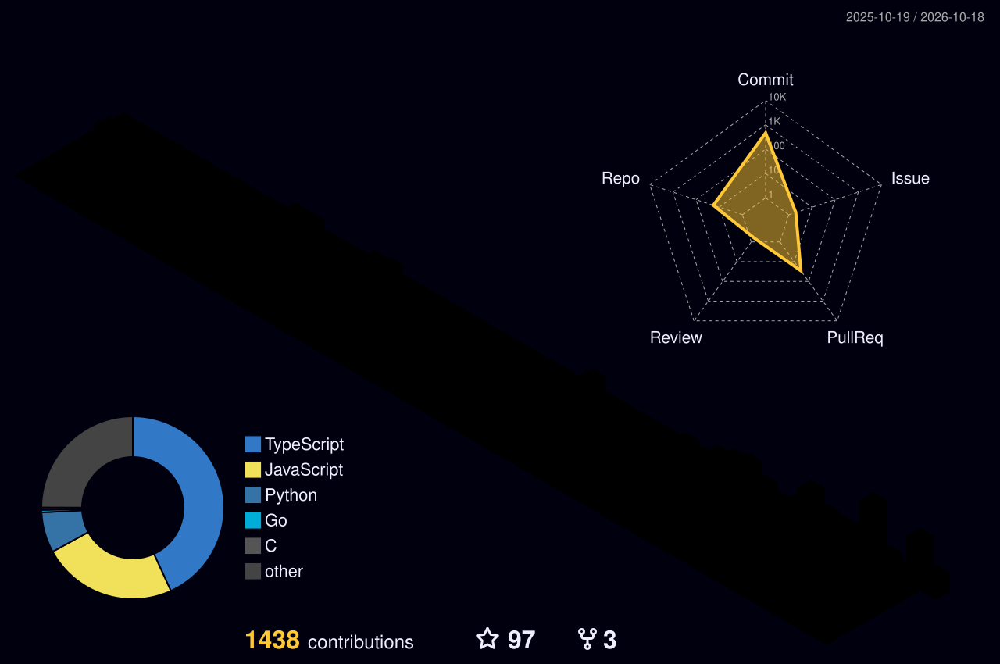

  <strong>Software Engineer · Full-stack &amp; AI/ML</strong> 
  SDE at Innovativus · B.Tech CSE, VIT · Uttarakhand, India

  <a href="https://www.linkedin.com/in/yuvrajnode">LinkedIn</a> &nbsp; / &nbsp;
  <a href="mailto:yuvrajsingh9027249999@gmail.com">Email</a> &nbsp; / &nbsp;
  <a href="https://github.com/yuvrajnode/resume">Recruiter overview</a> &nbsp; / &nbsp;
  <a href="#open-source">Open source</a> &nbsp; / &nbsp;
  <a href="#selected-projects">Selected projects</a>

I build LLM agents, retrieval systems and real-time web applications. My work spans Python and TypeScript backends, React interfaces, model evaluation, and Solana/Ethereum integrations. At work, my focus includes voice AI, speech synthesis and conversational assistants.

<!-- ─────────────────────────────  OPEN SOURCE  ───────────────────────────── -->

<h2 align="center">Open Source</h2>

  Eight projects, about 600k stars between them. Eight of my patches are merged upstream, and five more are in review.
   
  Mostly small correctness fixes in code I hit while building something else.

 

<table align="center" width="100%">
<tr>
<th align="left" width="32%">Project</th>
<th align="left" width="68%">Pull requests</th>
</tr>

<tr>
<td valign="top">

&nbsp; **[huggingface/&#8203;transformers](https://github.com/huggingface/transformers)**
 Python · the model library

</td>
<td valign="top">

&nbsp; [**#47509**](https://github.com/huggingface/transformers/pull/47509) Phi-4 Multimodal vision embedding init
 
&nbsp; [**#47558**](https://github.com/huggingface/transformers/pull/47558) Pix2Struct attention sized from `d_kv`

</td>
</tr>

<tr>
<td valign="top">

&nbsp; **[supabase/&#8203;supabase](https://github.com/supabase/supabase)**
 TypeScript · Postgres platform · Studio

</td>
<td valign="top">

&nbsp; [**#51385**](https://github.com/supabase/supabase/pull/51385) Default cron HTTP timeout when `timeout_milliseconds` is omitted
 
&nbsp;&nbsp;&nbsp;&nbsp;&nbsp; [**#51384**](https://github.com/supabase/supabase/pull/51384) Keep wrapper option values that contain `=`
 
&nbsp;&nbsp;&nbsp;&nbsp;&nbsp; [**#51383**](https://github.com/supabase/supabase/pull/51383) Parse quoted column names in foreign key constraints

</td>
</tr>

<tr>
<td valign="top">

&nbsp; **[fishaudio/&#8203;fish-speech](https://github.com/fishaudio/fish-speech)**
 Python · TTS and voice cloning

</td>
<td valign="top">

&nbsp; [**#1317**](https://github.com/fishaudio/fish-speech/pull/1317) Honour the `recursive` flag in `list_files()`
 
&nbsp; [**#1318**](https://github.com/fishaudio/fish-speech/pull/1318) Dispatch on type, not tuple length
 
&nbsp; [**#1319**](https://github.com/fishaudio/fish-speech/pull/1319) Validate reference args up front

</td>
</tr>

<tr>
<td valign="top">

&nbsp; **[safedep/vet](https://github.com/safedep/vet)**
 Go · supply-chain scanner

</td>
<td valign="top">

&nbsp; [**#757**](https://github.com/safedep/vet/pull/757) Propagate GitHub org scan errors
 
&nbsp; [**#760**](https://github.com/safedep/vet/pull/760) Match npm registry by hostname, not full URL
 
&nbsp;&nbsp;&nbsp; [**#761**](https://github.com/safedep/vet/pull/761) Surface malicious package lookups that never completed

</td>
</tr>

<tr>
<td valign="top">

&nbsp; **[n8n-io/n8n](https://github.com/n8n-io/n8n)**
 TypeScript · workflow automation

</td>
<td valign="top">

&nbsp;&nbsp;&nbsp;&nbsp;&nbsp; [**#40531**](https://github.com/n8n-io/n8n/pull/40531) AI Agent node: replay tool-call arguments with Anthropic thinking blocks
 
&nbsp;&nbsp;&nbsp;&nbsp;&nbsp; [**#40507**](https://github.com/n8n-io/n8n/pull/40507) Editor: skip the provisioning config request when it is unavailable
 
&nbsp;&nbsp;&nbsp;&nbsp;&nbsp; [**#40501**](https://github.com/n8n-io/n8n/pull/40501) Editor: keep all matching actions in node search
 
&nbsp;&nbsp;&nbsp; [**#20393**](https://github.com/n8n-io/n8n/pull/20393) Timezone-aware date formatting across the frontend

</td>
</tr>

<tr>
<td valign="top">

&nbsp; **[calcom/cal.diy](https://github.com/calcom/cal.diy)**
 TypeScript · scheduling

</td>
<td valign="top">

&nbsp;&nbsp;&nbsp; [**#29954**](https://github.com/calcom/cal.diy/pull/29954) Sort duration badges numerically

</td>
</tr>

<tr>
<td valign="top">

&nbsp; **[freebsd/&#8203;freebsd-src](https://github.com/freebsd/freebsd-src)**
 C · FreeBSD source tree

</td>
<td valign="top">

&nbsp;&nbsp;&nbsp; [**#2384**](https://github.com/freebsd/freebsd-src/pull/2384) libusb: Validate arguments before dereferencing the hotplug context
 
&nbsp;&nbsp;&nbsp; [**#2383**](https://github.com/freebsd/freebsd-src/pull/2383) libusb: Fix NULL dereference when a hotplug callback deregisters itself

</td>
</tr>

<tr>
<td valign="top">

&nbsp; **[processing/p5.js](https://github.com/processing/p5.js)**
 JavaScript · creative coding

</td>
<td valign="top">

&nbsp;&nbsp;&nbsp; [**#9027**](https://github.com/processing/p5.js/pull/9027) Clarify `p5.Vector` is always 3-component

</td>
</tr>

</table>

  
    <a href="https://github.com/search?q=is%3Apr+author%3Ayuvrajnode&type=pullrequests&s=updated&o=desc">All pull requests</a>
    &nbsp;·&nbsp;
    <a href="https://github.com/search?q=is%3Apr+author%3Ayuvrajnode+is%3Amerged&type=pullrequests">Merged only</a>
  

 

## Activity

---

**Let’s talk engineering:** [LinkedIn](https://www.linkedin.com/in/yuvrajnode) · [Email](mailto:yuvrajsingh9027249999@gmail.com)
